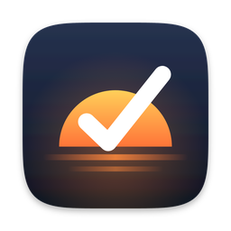

<p align="center"></p>

# Tagwerk

Tagwerk ist der Arbeitsname einer schlanken Mac-App für Tagesplanung, Fokus und Zeiterfassung. Zeiten auf Tickets gehen als Worklog an ManageEngine.

Der vollständige Plan steht im Dokument „Plan: Eigene Todo-App für den Mac“.

## Stand: Phase 4 plus Claude-Anbindung

Aufbau: dunkel und ruhig, oben die Leiste mit Start, Plan, Kalender, Fokus, Kunden und Rückblick.

| Bereich | Was geht |
| --- | --- |
| Befehlszeile | ⌘K oder „Was jetzt?“ oben rechts: eine Zeile für alles. Man tippt in normalem Deutsch, was man tut, darunter steht, was ↩ macht (↑↓ wählt, Esc schließt). „vpn“ startet „VPN-Störung prüfen“ (ein laufender Timer endet), „45m Telefonat Müller“ trägt die letzten 45 Minuten nach (neue erledigte Aufgabe beim Kunden Müller; lief ein Timer, wird die Zeit dort herausgeschnitten und er läuft danach weiter), „seit 9:30 Angebot“ startet rückwirkend, „morgen Bericht 30m“, „Freitag …“ oder „später …“ legt an, „krank“, „krank bis Freitag“ oder „Urlaub von Montag bis Freitag“ trägt die Abwesenheit ein, „Mittag“, „weiter“, „fertig“ und „stopp“ tun, was sie sagen, „Kalender“ oder „Feierabend“ springt dorthin. Ohne Eingabe schlägt sie das Naheliegende vor: laufende Aufgabe erledigen, Mittagspause, die nächsten Aufgaben, Standardaufgaben und morgens, solange noch keine Zeit läuft, „Heute krank eintragen“. Unten bestätigt eine kurze Meldung, was passiert ist. |
| Start | Großes Datum, Stunden heute und diese Woche. Links die Aufgaben von heute (neue oben oder unten einfügen, per Ziehen sortieren), darunter die Erledigt-Liste und der Eingang. Rechts der Tageskalender, an der Kante breiter ziehbar; die Lupen machen die Stunden höher. |
| Aufgabe öffnen | ⓘ beim Darüberfahren, Rechtsklick › „Öffnen …“ oder im Fokus „Aufgabe öffnen“: ein Fenster mit Titel, Planung, Kunde, Ziel, Ticket, Work Log Type, Unteraufgaben (umbenennen, Timer, löschen), Notizen, Bearbeitung und allen Zeiteinträgen. Doppelklick auf eine Aufgabe öffnet weiter den Fokus, Doppelklick auf eine Unteraufgabe benennt sie um. |
| Unteraufgaben | Beim Darüberfahren über eine Aufgabe das Listen-Symbol neben ▶, Rechtsklick › „Unteraufgabe hinzufügen“ oder im Fokus „Unteraufgaben“; geht in Start, Eingang, Woche und bei den Kunden. Claude legt sie über MCP mit `unteraufgabe_von` an. Jede Unteraufgabe hat ihren eigenen Timer und kann ein eigenes Ticket haben; Kunde und Ticket erbt sie sonst von der Aufgabe darüber. Im Tagesabschluss steht sie als eigene Zeile („Aufgabe: Unteraufgabe“). |
| Zeit nachtragen | Vergessen, den Timer zu starten? Auf Start „Eintragen“ › „Zeit nachtragen …“, ⌥⌘T, Rechtsklick auf eine Aufgabe › „Zeit nachtragen …“ oder im Fokus „Vergessen zu starten?“. Dort startet der Timer auch rückwirkend („läuft schon seit 15 Minuten“ oder „seit dem letzten Eintrag“), ohne sich mit erfassten Zeiten zu überschneiden. |
| Mittagspause | Gedacht für die richtige Pause, wenn du länger weg bist; kurze Unterbrechungen und Pomodoro-Pausen werden nicht eingetragen (bei Pomodoro hält nur die Zeit an). Oben rechts das Besteck neben dem laufenden Timer (oder ⇧⌘P, im Fokus „Mittagspause“): der Timer hält an, die Mittagspause läuft mit, „Weiter“ startet dieselbe Aufgabe wieder. Vergessen? Auf Start unter „Eintragen“ › „Mittagspause nachtragen …“ (Vorschlag 12:00–12:30), im Kalender oder per Doppelklick in eine freie Stelle; Arbeit, die in dieser Zeit erfasst war, wird dort herausgeschnitten. Die Mittagspause steht schraffiert im Kalender und im Tagesband, zählt nicht als Arbeitszeit und wird nicht gebucht. Der Tagesabschluss sagt, wenn nach dem Arbeitszeitgesetz Pause fehlt (ab 6 Stunden 30 Minuten, ab 9 Stunden 45 Minuten). |
| Standardaufgaben | Aufgaben wie „Organisatorisches“, „Interne Besprechung“ oder „Weiterbildung“: immer da, nie erledigt, nicht im Eingang. Auf Start unter „Standardaufgaben“ startet ein Klick die Zeit (noch ein Klick stoppt), daneben steht, wie viel es heute war. Rechtsklick › Details legt Kunde oder Ticket fest. Im Kalender stehen sie nach einem Doppelklick in eine vergangene Stelle zur Wahl, beim Nachtragen ganz oben. Anlegen und umbenennen mit „+“ auf Start oder in Einstellungen › Allgemein. |
| Krank und Urlaub | Auf Start der Knopf „Krank / Urlaub“ neben „Heute“, mit ⌘K („krank“, „krank bis Freitag“) oder in der Menüleiste „Heute krank eintragen“: „Heute krank“, halber Tag, mehrere Tage oder Urlaub (nur Arbeitstage). Im Kalender per Rechtsklick auf einen Tag. Das Wochenziel wird um diese Tage kleiner, offene Aufgaben rücken auf den nächsten Arbeitstag, Start zeigt einen Hinweis mit „Austragen“. Über Claude: „Trag mich heute krank ein“. |
| Ticket zuordnen | Jede eigene Aufgabe oder Unteraufgabe lässt sich einem Ticket zuordnen (Rechtsklick › „Ticket zuordnen“ oder der Ticket-Knopf im Fokus). Gesucht wird nach Nummer oder Betreff, auf Wunsch direkt in ManageEngine über alle Techniker (auch Tickets von Kollegen). Die Zeit geht dann zusätzlich als Worklog an das Ticket. |
| Ziele | Lange Ziele über Wochen, z. B. „AZ-305 bestehen“: Zieldatum, Stundenziel, Fortschrittsbalken und das nötige Tempo („≈ 4 h pro Woche nötig“). Aufgaben ordnest du per Rechtsklick › Ziel zu, ziehst sie auf ein Ziel oder legst sie direkt im Ziel an; ihre Zeit (auch die der Unteraufgaben) zählt mit. Die aktiven Ziele stehen auch auf Start und im Rückblick. ⌘6 öffnet die Ziele, der Rückblick ist jetzt ⌘7. |
| Plan | Woche planen: links der Eingang, daneben eine Spalte je Tag mit geplanter und freier Zeit. Aufgaben zieht man zwischen den Tagen hin und her. |
| Kalender | Die Woche mit Terminen, Zeitblöcken und erfasster Zeit in Kundenfarben, Stunden je Tag und gegen das Wochenziel. Doppelklick in eine freie Stelle legt dort gleich eine neue Aufgabe an: Titel eintippen, ↩. Was schon vorbei ist, wird als erfasste Zeit eingetragen (die Aufgabe gilt als erledigt), was noch kommt, als Zeitblock geplant; „…“ öffnet „Zeit nachtragen“ für eine bestehende Aufgabe oder einen Kunden. Das geht auch im Tageskalender auf Start. Erfasste Zeit lässt sich mit der Maus verschieben, an der oberen und unteren Kante zieht man Beginn und Ende (in Fünf-Minuten-Schritten, ohne andere Einträge zu überlappen); Doppelklick auf den Eintrag öffnet „Zeit bearbeiten“ mit Aufgabe, Tag, Von und Bis. |
| Tag planen | Geführte Planung beim ersten Öffnen am Tag: Übriges von gestern, Eingang, schätzen, in freie Lücken legen. |
| Tag abschließen | Zeiten je Aufgabe gerundet prüfen und anpassen. Aufgaben mit Ticket schicken ihre Zeit als Worklog an ManageEngine (freiwillig, nichts doppelt). „Liste kopieren“ gibt den Tag als Tabelle (Aufgabe, Kunde, Ticket, Stunden, Beschreibung) für Excel oder Numbers mit. |
| ManageEngine | Eigene offene Tickets landen im Eingang (Konto → Kunde). Zugang in den Einstellungen, der API-Schlüssel liegt im Schlüsselbund. |
| Pomodoro | Im Fokus oben „Pomodoro“ einschalten: 25 Minuten arbeiten (die große Uhr zählt herunter), dann 5 Minuten Pause, nach vier Runden 15 Minuten. In der Pause stoppen Zeit und Musik, die Pause zählt herunter; Ton und Mitteilung bei Pause und danach, „Weiter“ startet die nächste Runde mit derselben Aufgabe. Zeiten in Einstellungen › Fokus. |
| Fokus | Vollbild mit einer Aufgabe, großem Timer, Erledigt und Nächste. Ticket, Work Log Type und Bearbeitung klappen unten auf. Dazu Musik aus Apple Music, Internetradio, YouTube oder der eigenen Klangwelt: startet mit dem Timer und hält mit ihm an. |
| Kunden | Kennzahlen und eine Karte je Kunde mit Stunden dieser Woche und im Monat. Im Kunden: lokale Todos und ManageEngine-Konto. |
| Rückblick | Stunden gegen das Wochenziel, Tagesdurchschnitt, Anteil Kundenarbeit, Stunden je Tag und je Kunde, Verlauf der letzten Wochen, Wochenziele, Export als CSV. |
| Leerlauf | Läuft der Timer und kommt länger keine Eingabe, fragt Tagwerk nach der Rückkehr: Zeit behalten, abziehen oder einer anderen Aufgabe geben (auch einer Standardaufgabe). Ab 20 Minuten gibt es zusätzlich „Als Mittagspause eintragen“. |
| Schnell erfassen | ⌃⌥ Leertaste öffnet von überall ein kleines Fenster für neue Aufgaben. |
| Mails | Mails aus Outlook (oder .eml-Dateien) in den Eingang ziehen; Betreff und Absender werden übernommen. |
| Sicherung | Täglich eine Kopie der Datenbank, die letzten 14 bleiben. |
| Claude | Ein MCP-Server liegt in der App. Claude Desktop und Claude Code können damit Aufgaben, Timer, Zeiten und den Stand des Tagesabschlusses lesen und ändern. Gebucht wird weiter nur in Tagwerk. |
| Menüleiste | Laufende Zeit, Stoppen, Mittagspause, Erledigt, eine andere Aufgabe oder Standardaufgabe starten. |

Außerdem:

- Es läuft immer höchstens ein Timer. Ein neuer Start beendet den laufenden.
- Offene Aufgaben von gestern rutschen automatisch auf heute.
- Eine Zeitangabe am Ende des Titels wird zur Schätzung, z. B. „Angebot schreiben 1h30“ oder „Logs prüfen 45m“.

Noch nicht enthalten:

| Phase | Inhalt |
| --- | --- |
| 5 | Outlook |

## Herunterladen (ohne selbst zu bauen)

GitHub baut die App bei jedem Push und legt sie unter **Releases › „Tagwerk – aktueller Stand“** ab.

1. `Tagwerk.dmg` herunterladen und öffnen. Fester Link auf die jeweils neueste Fassung: <https://github.com/boberbeck/todo/releases/download/aktuell/Tagwerk.dmg>
2. Tagwerk auf „Programme“ ziehen und eine ältere Fassung ersetzen, danach die DMG auswerfen. (`Tagwerk.zip` ist dasselbe als ZIP.)
3. Beim ersten Öffnen blockt macOS die App, weil sie nicht von Apple beglaubigt ist: Systemeinstellungen › Datenschutz & Sicherheit › „Dennoch öffnen“. Alternativ im Terminal: `xattr -dr com.apple.quarantine /Applications/Tagwerk.app`
4. Fragt macOS nach dem Schlüsselbund, „Immer erlauben“ wählen. Damit das und die Kalender-Freigabe auch nach Updates bleiben, einmal die feste Signatur einrichten (siehe „Signieren“).

Daten und Einstellungen bleiben beim Ersetzen der App erhalten; sie liegen nicht in der App.

**Fehler melden:** Menü Aufgabe › „Fehler melden …“ oder Einstellungen › Allgemein. Tagwerk legt Beschreibung, Fassung, Zustand der Anbindungen und das Protokoll (`~/Library/Logs/Tagwerk/tagwerk.log`, ohne Passwörter und Schlüssel) zusammen; nach einem Absturz bietet es den Bericht von macOS gleich mit an. Dann als GitHub-Issue (Seite öffnet sich vorausgefüllt), als Datei in „Downloads“ oder als Text für den Chat mit Claude.

**Automatische Updates:** Einmal in Einstellungen › Allgemein › „Updates“ einen GitHub-Schlüssel eintragen, der nur lesen darf („Fine-grained token“, nur dieses Repository, Contents: Read-only). Danach schaut Tagwerk beim Start und alle sechs Stunden im Release „aktuell“ nach, zeigt, was neu ist, und ersetzt sich nach „Jetzt aktualisieren“ selbst; anschließend startet es neu. Die geladene App wird vorher geprüft (Kennung und Signatur).

## Starten

Voraussetzungen: macOS 14 oder neuer und Xcode 15.3 oder neuer.

1. Repository klonen und den Branch auschecken.
2. `open Package.swift` ausführen. Xcode öffnet das Paket. Das Schema „Tagwerk“ wählen und mit ⌘R starten.
3. Alternativ im Terminal: `swift run Tagwerk`.
4. Als App zum Doppelklicken: `scripts/make-app.sh` baut `build/Tagwerk.app`. Die kannst du in den Programme-Ordner ziehen.
5. Tests laufen mit `swift test`.
6. Zum Ausprobieren ohne eigene Daten: `swift run Tagwerk -TagwerkDemo YES` startet mit Beispieldaten. Die werden nicht gespeichert.

Screenshots aller Bildschirme liegen unter `docs/screenshots`. Die CI erzeugt sie neu, wenn eine Commit-Nachricht `[screenshots]` enthält.

Für den Kalenderzugriff am besten `scripts/make-app.sh` nutzen und `build/Tagwerk.app` starten. macOS fragt dann einmal nach dem Zugriff auf die Kalender. In den Einstellungen (⌘,) legst du Arbeitszeit, Kalender und Zeitblöcke fest. Ist dein Exchange-Konto im macOS-Kalender eingerichtet, erscheinen dort auch die Outlook-Termine.

## Termine als Zeit erfassen

Termine aus dem Kalender werden per Rechtsklick oder Doppelklick › „Als Zeit erfassen …“ zur erfassten Zeit, mit Kunde; Tagwerk merkt sich den Kunden je Termintitel. Im Tagesabschluss ist der Worklog im Ticket freiwillig („Ohne Worklog“).

SAP ByDesign ist nicht mehr eingebaut. Beim ersten Start der neuen Fassung räumt Tagwerk das gespeicherte ByDesign-Passwort, die Anmeldung im früheren ByDesign-Fenster und die Einstellungen dazu weg. Alte Daten in der Datenbank bleiben unangetastet, werden aber nicht mehr gelesen.

## Claude anbinden (MCP)

`scripts/make-app.sh` baut `build/Tagwerk.app` und legt den MCP-Server `tagwerk-mcp` neben die App: `Tagwerk.app/Contents/MacOS/tagwerk-mcp`. `scripts/make-dmg.sh` packt die App danach in `build/Tagwerk.dmg`.

- **Claude Desktop:** Einstellungen › Claude › „In Claude Desktop eintragen“, danach Claude Desktop neu starten. Von Hand geht es über `~/Library/Application Support/Claude/claude_desktop_config.json`:

  ```json
  {
    "mcpServers": {
      "tagwerk": { "command": "/Applications/Tagwerk.app/Contents/MacOS/tagwerk-mcp" }
    }
  }
  ```

- **Claude Code:** `claude mcp add --scope user tagwerk -- /Applications/Tagwerk.app/Contents/MacOS/tagwerk-mcp`

- **Claude im Browser und auf dem Handy (z. B. ein privates Konto):** Einstellungen › Claude › „Claude im Browser und auf dem Handy“. Solange Tagwerk läuft, startet es `tagwerk-mcp --http` nur auf diesem Mac (127.0.0.1) und auf Wunsch einen Tunnel, über den claude.ai den Mac erreicht. Am einfachsten ist [Tailscale Funnel](https://tailscale.com/kb/1223/funnel) mit fester Adresse (`tailscale funnel {port}`); ngrok mit fester Adresse oder Cloudflare (neue Adresse bei jedem Start) gehen auch. Die angezeigte Adresse (`https://…/mcp/<schlüssel>`) in claude.ai unter Einstellungen › Connectors als eigenen Connector eintragen; dann steht Tagwerk auch in der Claude-App auf dem Handy bereit. Der lange Schlüssel im Pfad schützt den Zugang (liegt im Schlüsselbund, „Neuer Schlüssel“ sperrt die alte Adresse). Der Mac muss an sein.

Werkzeuge: `tagesuebersicht`, `aufgaben`, `aufgabe_anlegen`, `aufgabe_aendern`, `timer_starten`, `timer_stoppen`, `zeitauswertung`, `tagesabschluss`, `kunden`, `wochenziele`, `wochenziel_anlegen`, `ziele`, `ziel_anlegen`. Der Server arbeitet direkt auf der Datenbank; die geöffnete App lädt Änderungen innerhalb einer Sekunde nach. An ManageEngine sendet Claude nichts. Mit der Umgebungsvariable `TAGWERK_DB` lässt sich eine andere Datenbank angeben, z. B. zum Ausprobieren.

## Signieren (einmal einrichten, damit Freigaben bleiben)

macOS merkt sich die Freigaben für Kalender, Schlüsselbund (ManageEngine-Schlüssel) und Musik anhand der Signatur der App. Ohne festes Zertifikat ist jede neue Fassung für macOS eine andere App, und die Freigaben gehen verloren.

Am einfachsten in der App: Einstellungen › Allgemein › „Freigaben behalten“ › „Zertifikat erzeugen“, dann die zwei angezeigten Secrets bei GitHub eintragen. Oder auf dem eigenen Mac im Repository ausführen:

```
scripts/signatur-einrichten.sh
```

Das Skript erzeugt ein selbst signiertes Zertifikat „Tagwerk Lokal“, legt es in deinen Schlüsselbund (dann signiert auch `scripts/make-app.sh` damit) und hinterlegt es bei GitHub als Secret `TAGWERK_SIGNING_P12` mit Passwort `TAGWERK_SIGNING_PASSWORD`. Mit der GitHub-CLI (`gh`) geht das automatisch, sonst führt das Skript durch die zwei Einträge auf der GitHub-Seite. Ab dem nächsten Build sind die Downloads damit signiert; danach einmal Kalender und Schlüsselbund freigeben („Immer erlauben“), dann bleibt es so.

Ohne Zertifikat signiert der Build ad hoc. Den API-Schlüssel liest Tagwerk erst, wenn es wirklich mit ManageEngine spricht, und nur einmal pro Start.

## Weg zum iPhone (vorbereitet)

Eine iPhone-Fassung gibt es noch nicht, der Umstieg ist aber vorbereitet:

- **Der Kern läuft auf dem iPhone.** `TagwerkCore` (Datenmodell, Zeitlogik, Datenbank, ManageEngine) hängt nur an Foundation und SQLite; die CI baut ihn bei jedem Push zusätzlich für iOS.
- **Die Datenbank merkt sich Änderungen.** Jede Zeile hat `modified_at`, Gelöschtes landet in `deleted_record`; `SQLiteStore.changes(since:)` liefert, was sich seit einem Zeitpunkt geändert hat. Trigger erfassen auch Änderungen des MCP-Servers. Alle Einträge haben UUIDs, damit Geräte ohne Zusammenstöße zusammenführen können.

Noch zu tun, sobald es losgeht:

1. Entscheidung zum Abgleich: iCloud (CloudKit, braucht das Apple-Entwicklerkonto, 99 € im Jahr) oder der Mac als Server für eine Web-App im WLAN oder per Tailscale (ohne Konto).
2. Abgleich auf Basis von `changes(since:)` bauen (letzte Änderung gewinnt, Löschungen zuerst).
3. iPhone-App-Ziel anlegen: Heute, Timer, Schnell erfassen, Fokus mit Musik (dort über MediaPlayer statt AppleScript), Eingang. Tagesabschluss und ManageEngine bleiben auf dem Mac.
4. Mit Konto: Signatur und TestFlight in der CI.

## Daten

Alle Daten liegen lokal in `~/Library/Application Support/Tagwerk/tagwerk.sqlite`. Time Machine sichert die Datei mit. Die App nutzt die SQLite-Bibliothek von macOS und braucht keine Fremdpakete.

## Tastenkürzel

| Kürzel | Aktion |
| --- | --- |
| ⌘K | Befehlszeile: starten, nachtragen, anlegen, Mittagspause, springen |
| ⌘N | Neue Aufgabe (auf Start) |
| ⌘T | Timer der Fokus-Aufgabe starten oder stoppen |
| ⌘↩ | Fokus-Aufgabe erledigt |
| ⌘1 bis ⌘7 | Start, Plan, Kalender, Fokus, Kunden, Ziele, Rückblick |
| ⌥⌘T | Zeit nachtragen |
| ⇧⌘P | Mittagspause starten oder beenden (danach weiter mit derselben Aufgabe) |
| ⌘0 | Tag planen |
| ⌘9 | Tag abschließen |
| Esc | Fokus verlassen |
| ⌃⌥ Leertaste | Schnell erfassen, auch wenn Tagwerk im Hintergrund ist |
| Doppelklick auf eine Aufgabe | im Fokus öffnen |

## Musik im Fokus

Unter Einstellungen › Fokus (oder im Fokus über das Notensymbol) wählst du die Quelle. Die Musik startet, sobald du im Fokus den Timer startest, hält in der Pomodoro-Pause an und, wenn gewünscht, beim Stoppen des Timers.

- **Apple Music:** eine Playlist aus der Musik-App. Tagwerk steuert die Musik-App per AppleScript; macOS fragt beim ersten Mal, ob Tagwerk das darf (Systemeinstellungen › Datenschutz & Sicherheit › Automation).
- **Internetradio:** werbefreie Sender, überwiegend ohne Gesang, nach Richtung: Ambient & Chill (Drone Zone, Deep Space One, Space Station Soma, Fluid) und Elektronik (Synphaera, cliqhop idm, DEF CON Radio), alle von SomaFM. Dazu eine eigene Stream-Adresse (MP3/AAC). Spielt direkt in Tagwerk, der laufende Titel erscheint, wenn der Sender ihn mitschickt.
- **YouTube:** einen Link einfügen (Video, Playlist, Mix oder Livestream; liegt einer in der Zwischenablage, schlägt Tagwerk ihn vor). Er spielt mit dem offiziellen Player im Fokus: das Bild bleibt klein sichtbar (nur Ton erlaubt YouTube bei eingebetteten Videos nicht), aber ohne YouTube-Bedienleiste, gesteuert über die Knöpfe von Tagwerk; verlässt du den Fokus, hält das Video an. Zuletzt gespielte Links stehen im Verlauf (Notensymbol im Fokus und Einstellungen › Fokus).
- **Klangwelt:** Musik, die Tagwerk selbst erzeugt, endlos und offline: warmer Klangteppich, vereinzelte Glockentöne aus derselben Tonleiter, leises Rauschen, ohne Gesang. Passt sich an: morgens heller und lebendiger, abends tiefer, langsamer und in Moll; beim Tippen lebendiger, beim Lesen und Nachdenken ruhiger. Stimmungen: Fokus, Tiefe Konzentration, Ruhig.

## Aufbau

| Pfad | Inhalt |
| --- | --- |
| `Sources/TagwerkCore` | Datenmodell, Zeitlogik, Tagesplan-Regeln, SQLite-Speicher. Ohne Oberfläche und unter Linux testbar. |
| `Sources/TagwerkApp` | SwiftUI-Oberfläche, nur macOS |
| `Sources/TagwerkMCP` | MCP-Server (JSON-RPC über stdin/stdout) und die Werkzeuge für Claude |
| `Sources/tagwerk-mcp` | Startprogramm des MCP-Servers |
| `Support` | Info.plist und App-Symbol (`AppIcon.svg` ist die Vorlage) |
| `Tests/TagwerkCoreTests` | Tests für die Kernlogik |
| `Tests/TagwerkMCPTests` | Tests für den MCP-Server |
